# Digital Integrated Circuits & VLSI Design (HSPICE & Tanner L-Edit)

[](https://opensource.org/licenses/MIT)
[](#simulation--reproduction-guide)
[](#5-full-custom-physical-vlsi-layout-05-physical-vlsi-layout-ledit)
[](#coursework-module-summary)
[](https://ut.ac.ir)

Comprehensive VLSI circuit design, HSPICE characterization, and physical mask layout portfolio developed at the School of Electrical and Computer Engineering, **University of Tehran**.

This repository spans multi-node **Synopsys HSPICE** simulations (`PTM 180nm`, `TSMC 90nm LVT`, `PTM 32nm`), delay and thermal leakage modeling (`0°C` to `100°C`), static vs. differential vs. dynamic CMOS logic families, sequential clock-race analysis, and **Tanner S-Edit / L-Edit** schematic-to-layout design (`0.5 um` SCMOS `MHP_N05`) with parasitic SPICE extraction.

---

## Coursework Module Summary

| Module | Design Task & Circuit Under Test | Technology Node | Key Verified Metrics (`CA1`-`CA5` Reports & Netlists) |
|:---|:---|:---|:---|
| **CA1 (`01-`)** | MOSFET Parameter Extraction & Diode Sizing | `PTM 180nm` (`VDD=1.8V`) | NMOS: $k_n'=201\,\mu\text{A/V}^2$, $V_{th}=0.394\,\text{V}$; PMOS: $k_p'=60\,\mu\text{A/V}^2$, $V_{th}=0.277\,\text{V}$ |
| **CA2 (`02-`)** | 4-Bit Carry-Lookahead Adder (CLA) Thermal Sweep | `TSMC 90nm LVT` (`VDD=1.0V`) | Delay (`tpLH(Cout)`): `237.86 ps` (`0°C`), `244.51 ps` (`25°C`), `264.83 ps` (`100°C`); AVG power `171.5` to `186.3 uW` |
| **CA3 (`03-`)** | Static CMOS vs. DCVSL & Keeper `NAND3` | `PTM 32nm` (`VDD=1.0V`) | Static CMOS (`6` FETs): `tpHL=9.25 ps`, `tpLH=8.69 ps`; DCVSL (`14` FETs): `tpHL=13.89 ps`, `tpLH=22.76 ps` |
| **CA4 (`04-`)** | `AOI21` Elmore Delay, TG Register & `MEMORY` Pipeline | `PTM 32nm` (`VDD=1.0V`) | `AOI21`: `17RC` (~`23.8 ps`) / `21RC` (~`29.4 ps`); Register `v(q)` rise `154.9 ps`; Pipeline closes at $T=300\text{ ps}$ (`1.67 GHz`) |
| **CA5 (`05-`)** | Full-Custom `NAND4` & 4-Stage `ShiftRegister` Layout | `MOSIS SCMOS 0.5um` (`L=6um`) | `NAND4_extracted.sp` (`VDD=1.0V` testbench): `Cpar(VDD)=1.212 pF`, `Cpar(OUT)=636.86 fF` |

---

## System Hierarchy & Architecture

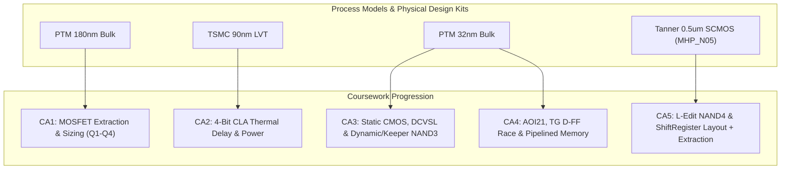

---

## Repository Organization

```text
Digital-Integrated-Circuits-VLSI-HSPICE/
├── 01-cmos-inverter-vtc-delay/             # CA1: 180nm I-V Parameter Extraction & Diode Sizing
│   ├── netlists/                           # PTM_180nm.txt, Q1_1..Q1_4, Q2_1..Q2_4, Q3_*, Q4.sp
│   └── tech_models/                        # 0.5micron.lib reference model
├── 02-thermal-power-leakage-analysis/      # CA2: 90nm 4-Bit CLA Thermal Delay & Power Sweeps
│   └── netlists/                           # Delay_{normal_temp,temp0,temp100}.sp, power_*.sp, MODEL_NOTICE.md
├── 03-logic-families-dcvsl-pseudo-nmos/    # CA3: Static CMOS, DCVSL & Dynamic/Keeper NAND3
│   └── netlists/                           # 32nm_bulk.l, CA3-Q1.sp, CA3-Q2.sp, STATIC_CMOS.sp, DCVSL.sp, NAND3.sp
├── 04-sequential-circuits-sram-memory/     # CA4: AOI21, TG D-FF Register & Pipelined Memory
│   └── netlists/                           # 32nm_bulk.{l,pm}, AOI21.sp, register.sp, MEMORY.sp
├── 05-physical-vlsi-layout-ledit/          # CA5: Full-Custom VLSI Mask Layout & RC Extraction
│   ├── layout/                             # Tanner L-Edit databases (NAND4_Layout.tdb, ShiftRegister_Layout.tdb)
│   ├── schematic/                          # Tanner S-Edit schematics (DFF.sdb, ShiftRegister.tpr)
│   ├── post_layout_spice/                  # Extracted SPICE netlists (NAND4_extracted.sp, ShiftRegister_extracted.sp)
│   └── tech/                               # SCMOS tech setup (MHP_N05.TDB, MHP_N05.EXT, MHP_N05.XST)
├── docs/
│   └── media/                              # Figures across CA1-CA5 (vtc/, timing/, sram/, layout/)
├── reports/                                # Complete Technical Reports & Unified LaTeX Paper
│   ├── Complete_Digital_Electronics_Coursework_Report_AlirezaNajafi.pdf # Merged 45-page portfolio
│   ├── Digital_Integrated_Circuits_VLSI_Report.tex                      # IEEEtran two-column LaTeX source
│   ├── DE_CA1_Inverter_VTC_Noise_Margins_AlirezaNajafi.pdf              # 9 pages
│   ├── DE_CA2_Thermal_Power_Leakage_AlirezaNajafi.pdf                   # 10 pages
│   ├── DE_CA3_Logic_Families_DCVSL_AlirezaNajafi.pdf                    # 9 pages
│   ├── DE_CA4_Complex_Gates_SRAM_AlirezaNajafi.pdf                      # 10 pages
│   └── DE_CA5_VLSI_Layout_Tanner_LEdit_AlirezaNajafi.pdf                # 7 pages
├── LICENSE
└── README.md
```

---

## Detailed Engineering Modules & Results

### 1. MOSFET Parameter Extraction & Sizing (`01-cmos-inverter-vtc-delay`)

In **`CA1`** (`PTM 180nm`, $V_{DD} = 1.8\,\text{V}$), square-law and channel-length modulation parameters were extracted across $V_{GS} \in [0.4, 1.0]\,\text{V}$ (`Q1` to `Q4`), followed by diode-connected body-effect mismatch analysis (`Q2_1.sp`) and PMOS sizing optimization (`Q4.sp`, $w_2$ swept from $0.1\,\mu\text{m}$ to $3.0\,\mu\text{m}$ at $V_{in} = 0.8\,\text{V}$):

| Device (`PTM 180nm`) | Extracted Transconductance Factor ($k'$) | Channel-Length Modulation ($\lambda$) | Threshold Voltage ($|V_{th}|$) |
|:---|:---:|:---:|:---:|
| **NMOS** | $k_n' = 201\,\mu\text{A/V}^2$ | $1.484\,\text{V}^{-1}$ | $0.394\,\text{V}$ |
| **PMOS** | $k_p' = 60\,\mu\text{A/V}^2$ | $0.900\,\text{V}^{-1}$ | $0.277\,\text{V}$ |

<p align="center">
  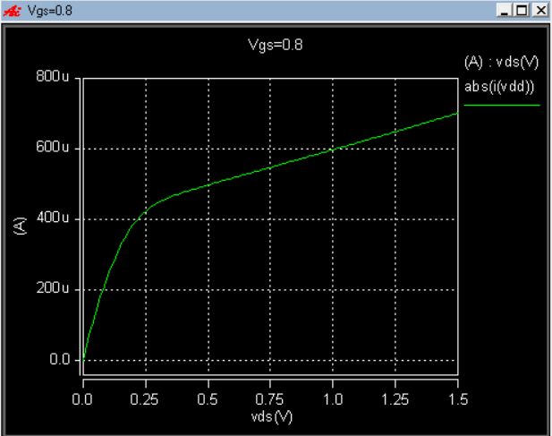
  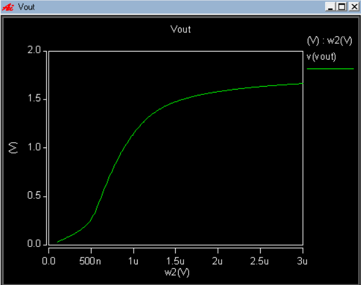
</p>

---

### 2. 4-Bit CLA Thermal Delay & Power Sweep (`02-thermal-power-leakage-analysis`)

A full 4-bit **Carry-Lookahead Adder (CLA)** was simulated in **`TSMC 90nm LVT`** ($V_{DD} = 1.0\,\text{V}$) across $0^\circ\text{C}$, $25^\circ\text{C}$ (nominal), and $100^\circ\text{C}$ (`Delay_*.sp` and `power_*.sp`, integrated over $t \in [0, 3.4244\,\text{ns}]$):

| Temperature Corner | `tpHL (S3)` | `tpLH (Cout)` [Critical] | Average Power (`pow1` over `3.4244 ns`) | Thermal Trend |
|:---|:---:|:---:|:---:|:---|
| **$0^\circ\text{C}$** | $195.33\,\text{ps}$ | **$237.86\,\text{ps}$** (`max=237.87 ps`) | **$171.53\,\mu\text{W}$** | Higher carrier mobility reduces critical delay |
| **$25^\circ\text{C}$ (Nominal)** | $201.03\,\text{ps}$ | **$244.51\,\text{ps}$** (`~244.6 ps`) | **$172.78\,\mu\text{W}$** | Nominal baseline corner |
| **$100^\circ\text{C}$** | $219.19\,\text{ps}$ | **$264.83\,\text{ps}$** | **$186.33\,\mu\text{W}$** | Mobility degradation increases delay (`+8.3%` vs `25C`) & power |

<p align="center">
  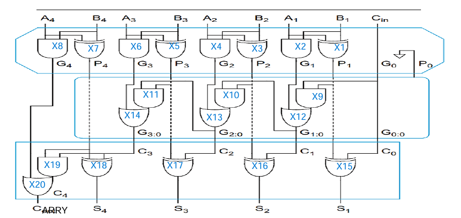
  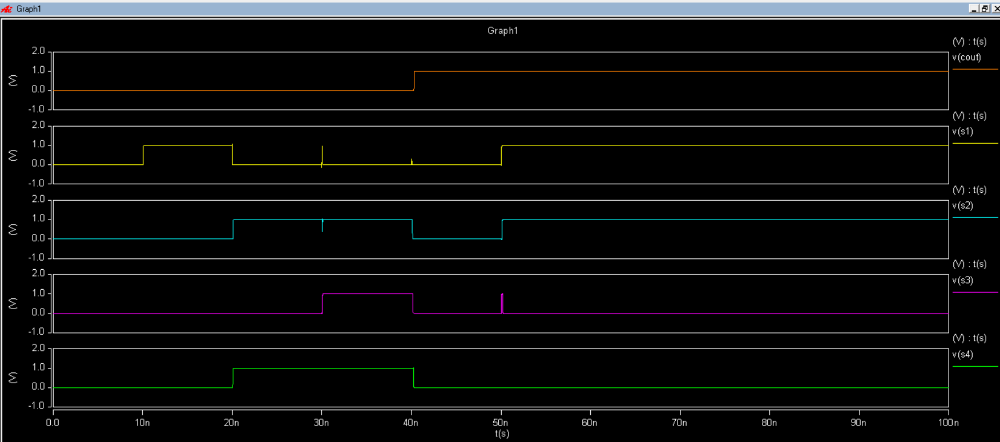
</p>

---

### 3. Logic Family Benchmarking (`03-logic-families-dcvsl-pseudo-nmos`)

Quantitative comparison between **Static CMOS** (`6` core FETs) and **Differential Cascode Voltage Switch Logic (DCVSL)** (`14` core FETs), alongside dynamic 3-input NAND charge-sharing mitigation (`NAND3.sp`) in **`PTM 32nm`** ($V_{DD} = 1.0\,\text{V}$):

| Logic Family (`PTM 32nm`, $1.0\,\text{V}$) | Core FETs | $t_{pHL}$ | $t_{pLH}$ | Static Power (`H` / `L`) | Dynamic Power (`LH` / `HL`) |
|:---|:---:|:---:|:---:|:---:|:---:|
| **Static CMOS** (`STATIC_CMOS.sp`) | 6 | **$9.2544\,\text{ps}$** (`thl2`) | **$8.6947\,\text{ps}$** (`tlh2`) | $20.53\,\text{nW}$ / $61.59\,\text{nW}$ | $1.648\,\mu\text{W}$ / $2.491\,\mu\text{W}$ |
| **DCVSL** (`DCVSL.sp`) | 14 | **$13.8884\,\text{ps}$** (`thl1`) | **$22.7624\,\text{ps}$** (`tlh2`) | $76.06\,\text{nW}$ / $84.46\,\text{nW}$ | $17.123\,\mu\text{W}$ / $17.036\,\mu\text{W}$ |

- **Dynamic `NAND3` Charge Sharing (`CA3-Q2.sp`)**: Without a pull-up keeper, internal junction charge redistribution causes output voltage droop for $t \ge 40\,\text{ns}$. Adding a feedback PMOS keeper (`Mbl` in `E_NAND3`) restores full logic-high rail stability.

<p align="center">
  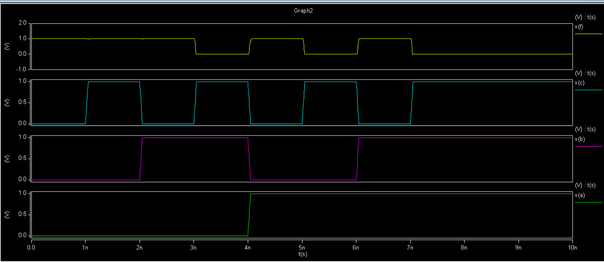
  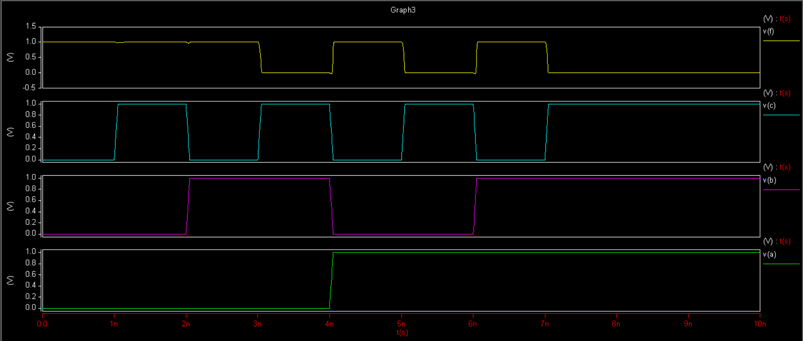
</p>

<p align="center">
  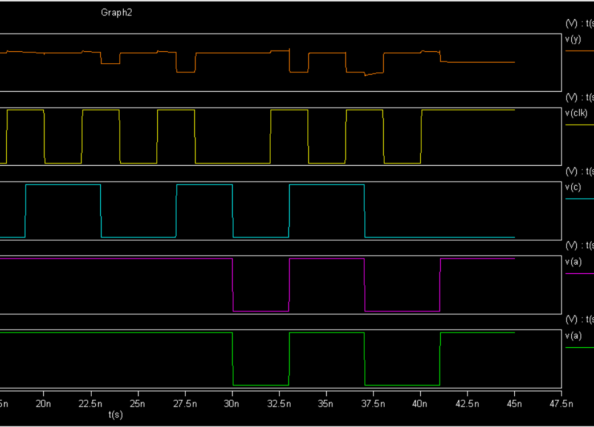
  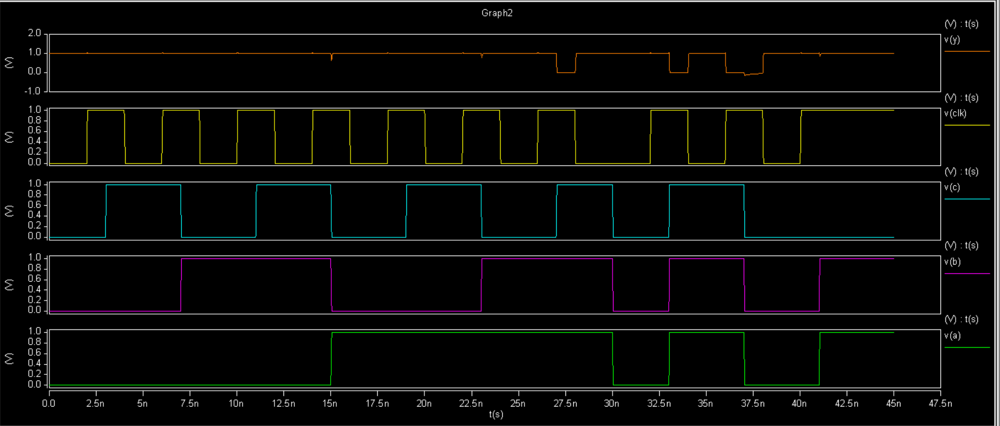
</p>

---

### 4. `AOI21`, Dynamic Register & Memory Pipeline (`04-sequential-circuits-sram-memory`)

- **`AOI21` Complex Gate Elmore Timing (`AOI21.sp`)**: Benchmarked against a unit `1x` inverter ($\approx 4.2\,\text{ps}$), analytical Elmore delay bounds predict $17RC \approx 23.8\,\text{ps}$ ($t_{pLH}$) and $21RC \approx 29.4\,\text{ps}$ ($t_{pHL}$).
- **Dynamic Transmission-Gate Register (`register.sp`)**: Verified output transition ($v(q)$ `10%-90%` rise from $6.1852\,\text{ns}$ to $6.3401\,\text{ns}$, $\Delta t = 154.9\,\text{ps}$) and analyzed `CLK` vs. `CLK_bar` race conditions across a 5-inverter clock-delay chain.
- **Pipelined Memory Timing (`MEMORY.sp`)**: Simulated across clock half-periods (`100 ps`, `200 ps`, `300 ps`); clean state capture and setup compliance holds at $T = 300\,\text{ps}$ ($1.67\,\text{GHz}$ clock), while `100 ps` and `200 ps` violate pipeline setup limits.

<p align="center">
  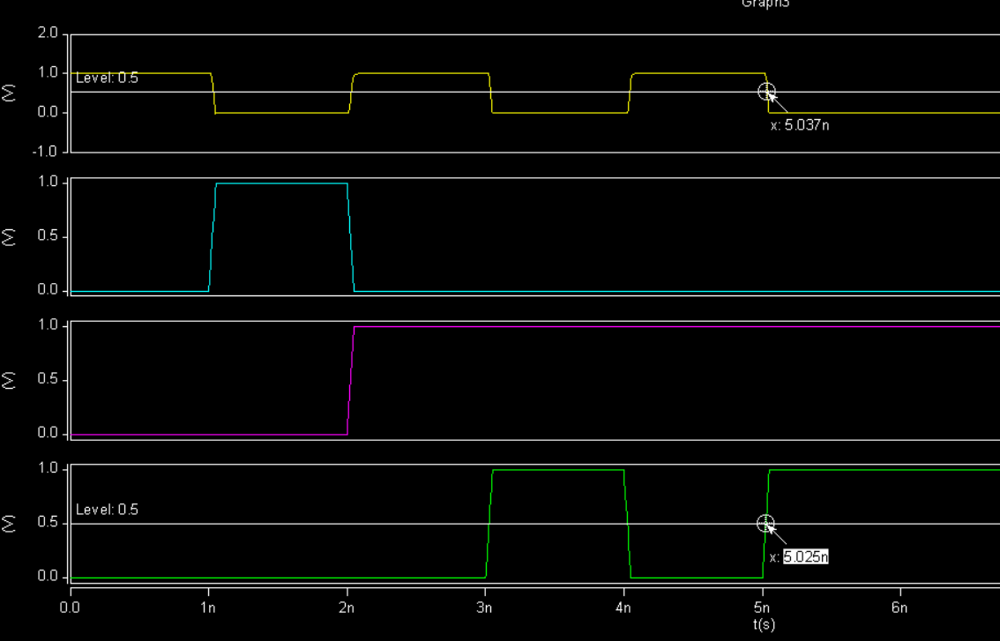
  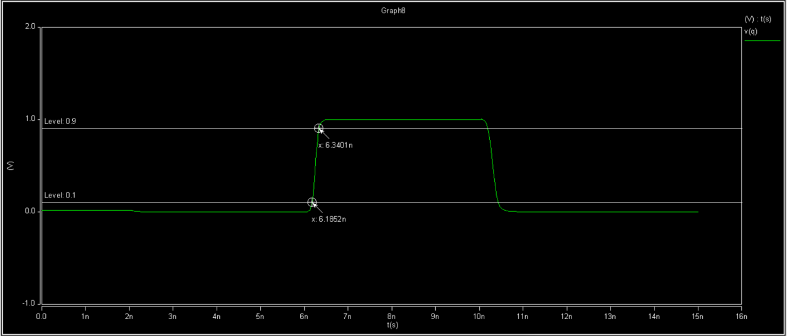
</p>

---

### 5. Full-Custom Physical VLSI Layout (`05-physical-vlsi-layout-ledit`)

Physical mask layout and schematic capture executed in **Tanner L-Edit & S-Edit** using the **$0.5\,\mu\text{m}$ MOSIS SCMOS** process (`MHP_N05.TDB`, minimum drawn gate length $L = 6\,\lambda$ / $0.5\,\mu\text{m}$ grid):
- **Full-Custom `NAND4` Gate (`NAND4_Layout.tdb`)**: Designed with shared drain/source active strips, N-well/substrate ties, and extracted via `MHP_N05.EXT` into `NAND4_extracted.sp` (`VDD = 1.0 V` testbench), capturing extracted parasitic node capacitances of **$C_{par}(V_{DD}) = 1.212\,\text{pF}$** and **$C_{par}(\text{OUT}) = 636.86\,\text{fF}$**.
- **4-Stage Serial `ShiftRegister` (`ShiftRegister_Layout.tdb`)**: Hierarchical D-flip-flop (`DFF.sdb` in S-Edit) tiled into a multi-bit layout with routed `CLK`, `VDD`, and `GND` rails.

<p align="center">
  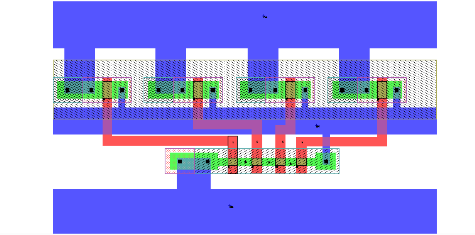
  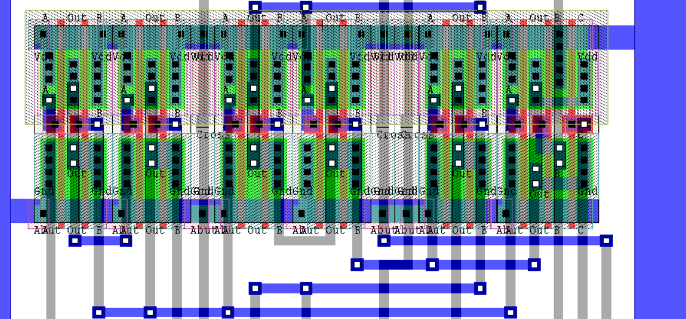
</p>

---

## Complete Coursework Portfolio Reports

All verified reports and the IEEE LaTeX synthesis paper are archived in [`reports/`](reports/):

| Report Document | Pages | Focus Area | Direct Link |
|:---|:---:|:---|:---:|
| **Unified Coursework Portfolio** | 45 | Merged original Persian coursework portfolio (`CA1` to `CA5`) | [Complete Portfolio PDF](reports/Complete_Digital_Electronics_Coursework_Report_AlirezaNajafi.pdf) |
| **IEEE Conference Summary (LaTeX)** | 2 | Two-column IEEEtran technical summary (`CA1` to `CA5`) | [LaTeX Source](reports/Digital_Integrated_Circuits_VLSI_Report.tex) |
| **CA1: MOSFET Parameter Extraction** | 9 | `PTM 180nm` I-V extraction, body effect, and `Q4` width sweep | [CA1 Report PDF](reports/DE_CA1_Inverter_VTC_Noise_Margins_AlirezaNajafi.pdf) |
| **CA2: 4-Bit CLA Thermal Characterization** | 10 | `TSMC 90nm LVT` 4-bit CLA delay/power at `0°C`, `25°C`, `100°C` | [CA2 Report PDF](reports/DE_CA2_Thermal_Power_Leakage_AlirezaNajafi.pdf) |
| **CA3: Static CMOS vs. DCVSL & Keeper `NAND3`** | 9 | `PTM 32nm` delay, static/dynamic power, and charge-sharing fix | [CA3 Report PDF](reports/DE_CA3_Logic_Families_DCVSL_AlirezaNajafi.pdf) |
| **CA4: `AOI21`, TG Register & Pipeline Memory** | 10 | `PTM 32nm` Elmore delay, clock-skew race, and `1.67 GHz` pipeline | [CA4 Report PDF](reports/DE_CA4_Complex_Gates_SRAM_AlirezaNajafi.pdf) |
| **CA5: Tanner L-Edit `NAND4` & Shift Register** | 7 | `0.5um` SCMOS physical mask design and parasitic extraction | [CA5 Report PDF](reports/DE_CA5_VLSI_Layout_Tanner_LEdit_AlirezaNajafi.pdf) |

---

## Simulation & Reproduction Guide

### Prerequisites
- **Synopsys HSPICE** (Version 2013 or newer).
- **Custom WaveView / CosmosScope** or Python `matplotlib` for waveform inspection.
- **Tanner Tools v13 / v16** (L-Edit for mask layout, S-Edit for schematic capture).

### Running HSPICE Simulations

#### 1. MOSFET Extraction & Sizing (Module 1)
```bash
cd 01-cmos-inverter-vtc-delay/netlists
hspice Q1_1.sp -o Q1_1.lis
hspice Q4.sp -o Q4.lis
```

#### 2. 4-Bit CLA Thermal Sweep (Module 2)
```bash
cd 02-thermal-power-leakage-analysis/netlists
hspice Delay_normal_temp.sp -o Delay_normal.lis
hspice Delay_temp0.sp -o Delay_temp0.lis
hspice Delay_temp100.sp -o Delay_temp100.lis
hspice power_normal.sp -o power_normal.lis
```

#### 3. Logic Family Benchmarking (Module 3)
```bash
cd 03-logic-families-dcvsl-pseudo-nmos/netlists
hspice CA3-Q1.sp -o CA3-Q1.lis
hspice CA3-Q2.sp -o CA3-Q2.lis
hspice STATIC_CMOS.sp -o STATIC_CMOS.lis
hspice DCVSL.sp -o DCVSL.lis
hspice NAND3.sp -o NAND3.lis
```

#### 4. Sequential Logic & Memory Pipeline (Module 4)
```bash
cd 04-sequential-circuits-sram-memory/netlists
hspice AOI21.sp -o AOI21.lis
hspice register.sp -o register.lis
hspice MEMORY.sp -o MEMORY.lis
```

#### 5. Post-Layout Parasitic Netlist Simulation (Module 5)
```bash
cd 05-physical-vlsi-layout-ledit/post_layout_spice
hspice NAND4_extracted.sp -o NAND4_extracted.lis
```

### Opening Physical Layouts in Tanner L-Edit
1. Launch **Tanner L-Edit**.
2. Open design database: `05-physical-vlsi-layout-ledit/layout/NAND4_Layout.tdb` or `ShiftRegister_Layout.tdb`.
3. Load technology setup file: `05-physical-vlsi-layout-ledit/tech/MHP_N05.TDB`.
4. Extract SPICE netlist via **Tools -> Extract -> Run Extract** using `05-physical-vlsi-layout-ledit/tech/MHP_N05.EXT`, and inspect stackup cross-sections with `MHP_N05.XST`.

---

## Academic Integrity & Course Metadata

- **Course**: Digital Integrated Circuits / Digital Electronics (الکترونیک دیجیتال)
- **Instructor**: **Dr. Shaghayegh Vahdat** (دکتر شقایق وحدت)
- **Institution**: School of Electrical and Computer Engineering, **University of Tehran**
- **Academic Term**: Fall 2023 (پاییز ۱۴۰۲)
- **Author**: **Alireza Najafi Motiei** (`810100224`)

---

## Key References

1. **J. M. Rabaey, A. Chandrakasan, and B. Nikolic**, *Digital Integrated Circuits: A Design Perspective*, 2nd Edition, Prentice Hall, 2003.
2. **S. M. Kang and Y. Leblebici**, *CMOS Digital Integrated Circuits: Analysis and Design*, 3rd Edition, McGraw-Hill, 2003.
3. **N. H. E. Weste and D. M. Harris**, *CMOS VLSI Design: A Circuits and Systems Perspective*, 4th Edition, Addison-Wesley, 2011.
4. **MOSIS SCMOS Design Rules**, MOSIS Integrated Circuit Layout Standards, Rev 8.0.
5. **Predictive Technology Model (PTM)**, Nanoscale CMOS Transistor Models, Arizona State University.
